# 🖥️ Iniciación a la Virtualización y Contenedores con Docker

**Informe técnico**

| | |
|---|---|
| **Alumno/a** | _Miruna Georgiana Matei_ |
| **Curso / Módulo** | DAW2 – _Despliegue de Aplicaciones Web_ |
| **Fecha** | _10/11/2026_ |
| **Entorno** | Ubuntu 24.04 LTS sobre VirtualBox |

---

## 📑 Índice

1. [Introducción](#1-introducción)
2. [Instalación de Ubuntu en VirtualBox](#2-instalación-de-ubuntu-en-virtualbox)
3. [Instalación de Docker en Ubuntu](#3-instalación-de-docker-en-ubuntu)
4. [Contenedores de servidor web y de aplicaciones](#4-contenedores-de-servidor-web-y-de-aplicaciones)
5. [Requerimientos para implantar una aplicación web](#5-requerimientos-para-implantar-una-aplicación-web)
6. [Conclusiones](#6-conclusiones)
7. [Criterios de evaluación cubiertos](#7-criterios-de-evaluación-cubiertos)

---

## 1. Introducción

### 1.1 ¿Qué es la virtualización?

La **virtualización** es una tecnología que permite ejecutar varios sistemas operativos o entornos de software independientes en una misma máquina física, mediante el uso de **hipervisores** (VirtualBox, VMware, Hyper-V, etc.). Cada entorno virtual recibe el nombre de **máquina virtual (VM)**.

### 1.2 Conceptos clave

| Concepto | Descripción |
|---|---|
| **Hipervisor** | Software que crea y gestiona las máquinas virtuales. |
| **Imagen ISO** | Archivo que contiene una copia exacta de un sistema operativo o software de instalación. |
| **Recursos virtualizados** | CPU, memoria RAM, almacenamiento y red asignados a cada VM. |

### 1.3 Contenedores vs. máquinas virtuales

Un **contenedor** empaqueta el código, las dependencias y la configuración necesarias para ejecutar una aplicación. A diferencia de una VM, los contenedores **comparten el kernel** del sistema operativo anfitrión, por lo que son más ligeros y rápidos.

| Característica | Máquina virtual | Contenedor |
|---|---|---|
| Sistema operativo | Uno completo por VM | Comparte el kernel del host |
| Peso | GBs | MBs |
| Arranque | Minutos | Segundos |
| Aislamiento | Muy alto (hardware virtual) | Alto (a nivel de proceso) |

**Ventajas de Docker:** ✅ Portabilidad · ✅ Aislamiento · ✅ Escalabilidad · ✅ Rapidez de despliegue

---

## 2. Instalación de Ubuntu en VirtualBox

### 2.1 Descarga de la ISO

Se descargó la imagen ISO de **Ubuntu 24.04 LTS** desde la página oficial de Ubuntu: <https://ubuntu.com/download/desktop>

### 2.2 Creación de la máquina virtual

Se creó una nueva máquina virtual en VirtualBox con la siguiente configuración:

| Parámetro | Valor |
|---|---|
| **Nombre** | `Ubuntu-DAW2DAW` |
| **Tipo / Versión** | Linux / Ubuntu (64-bit) |
| **RAM** | 4096 MB |
| **Disco duro virtual** | Mínimo 50 GB |
| **Tipo de red** | NAT |


### 2.3 Instalación de Guest Additions

Se instalaron las **Guest Additions** para mejorar la integración con el anfitrión (resolución de pantalla automática, portapapeles compartido, carpetas compartidas, etc.).

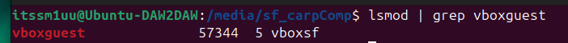

### 2.4 Resultado: escritorio instalado

Captura del escritorio de Ubuntu una vez finalizada la instalación:

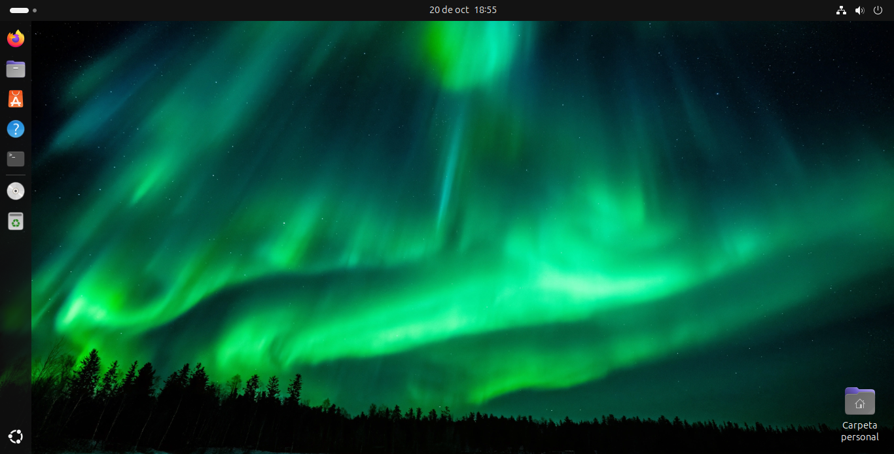

---

## 3. Instalación de Docker en Ubuntu

### 3.1 Actualización de repositorios

```bash
sudo apt update && sudo apt upgrade -y
```

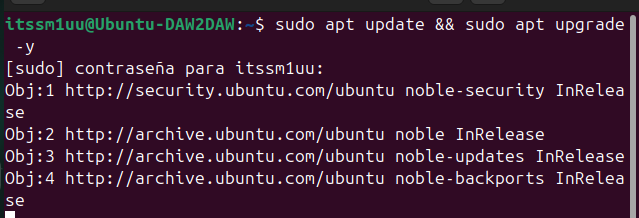

### 3.2 Instalación de dependencias

```bash
sudo apt install ca-certificates curl gnupg -y
```

| Paquete | Función |
|---|---|
| `ca-certificates` | Certificados raíz para conexiones HTTPS seguras. |
| `curl` | Descarga de archivos y scripts desde la red. |
| `gnupg` | Verificación de firmas GPG de los repositorios. |

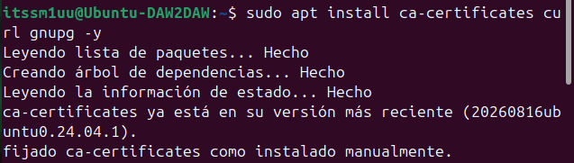

### 3.3 Añadir el repositorio de Docker e instalar

```bash
curl -fsSL https://get.docker.com | sudo sh
sudo apt install docker-desktop -y
```

El primer comando descarga y ejecuta el script oficial de Docker, que añade el repositorio y configura el sistema.

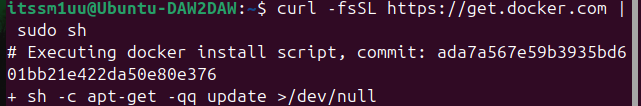

El segundo paso realiza la instalación de Docker.

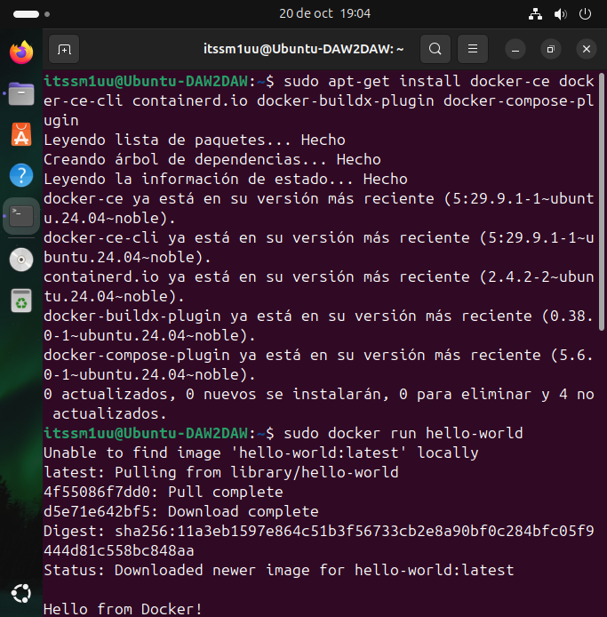

### 3.4 Verificación de la instalación

```bash
docker --version
docker run hello-world
```

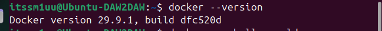

Resultado de `docker run hello-world` (mensaje _"Hello from Docker!"_ que confirma el correcto funcionamiento):

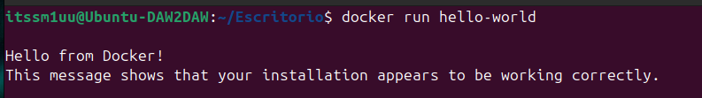

---

## 4. Contenedores de servidor web y de aplicaciones

### 4.1 Conceptos

| Tipo | Función | Ejemplos |
|---|---|---|
| **Servidor web** | Atiende peticiones HTTP/HTTPS y sirve contenido estático. | Nginx, Apache |
| **Servidor de aplicaciones** | Ejecuta la lógica de negocio (aplicaciones Java, etc.). | Tomcat, WildFly |

### 4.2 Búsqueda de imágenes disponibles

```bash
docker search nginx
docker search tomcat
```

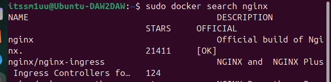

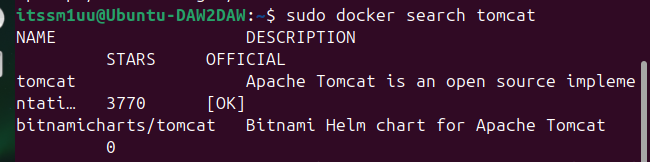

### 4.3 Descarga y ejecución de los contenedores

```bash
docker run -d -p 8080:80 --name webserver nginx
docker run -d -p 8081:8080 --name appserver tomcat
```

| Opción | Significado |
|---|---|
| `-d` | Ejecuta el contenedor en segundo plano (_detached_). |
| `-p host:contenedor` | Publica un puerto del contenedor en el host. |
| `--name` | Asigna un nombre al contenedor. |

| Contenedor | Imagen | Puerto host → contenedor | Rol |
|---|---|---|---|
| `webserver` | `nginx` | `8080 → 80` | Servidor web |
| `appserver` | `tomcat` | `8081 → 8080` | Servidor de aplicaciones |

**Contenedor Nginx:**

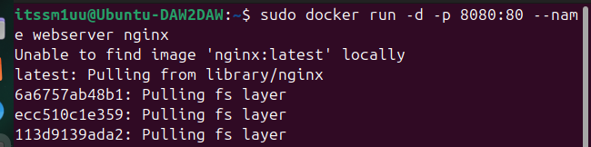

**Contenedor Tomcat:**

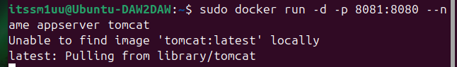

### 4.4 Verificación de contenedores activos

```bash
docker ps
```

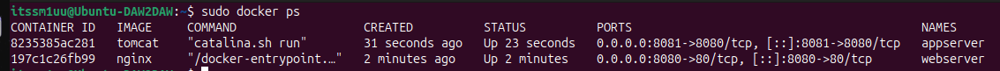

### 4.5 Pruebas de funcionamiento desde el navegador

| Servicio | URL |
|---|---|
| Nginx | <http://localhost:8080> |
| Tomcat | <http://localhost:8081> |

**Nginx** – página _"Welcome to nginx!"_:

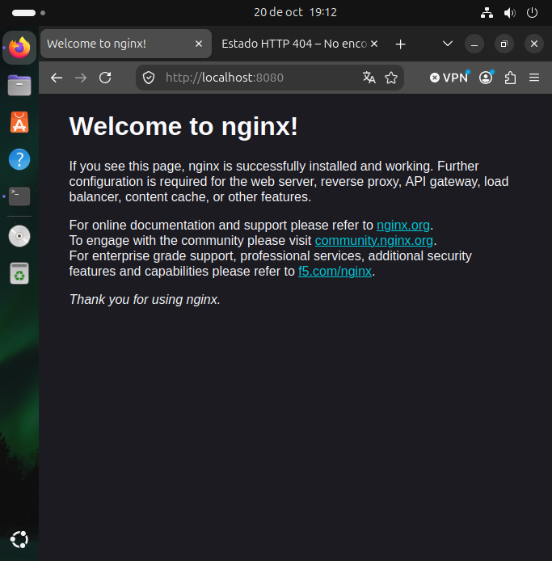

**Tomcat** – página de inicio de Apache Tomcat:

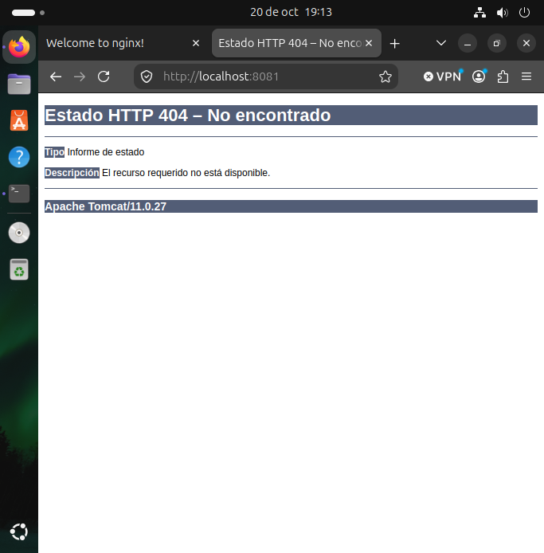

> En Tomcat, la imagen oficial puede mostrar un error 404 en la raíz porque la carpeta `webapps` viene vacía por defecto (las aplicaciones de ejemplo están en `webapps.dist`).

---

## 5. Requerimientos para implantar una aplicación web

### 5.1 Requisitos de hardware y software

**Hardware (orientativo, entorno pequeño/medio):**

| Recurso | Mínimo | Recomendado |
|---|---|---|
| CPU | 2 núcleos | 4 o más núcleos |
| RAM | 2 GB | 4–8 GB (según carga y nº de servicios) |
| Almacenamiento | 20 GB | SSD de 50 GB o más |
| Red | 100 Mbps | 1 Gbps |

**Software:**

- **Sistema operativo:** Linux servidor (Ubuntu Server, Debian, etc.) o Windows Server.
- **Servidor web:** Nginx o Apache HTTP Server.
- **Servidor de aplicaciones:** Tomcat, WildFly, etc. (con el JDK correspondiente si es Java).
- **Base de datos:** MySQL/MariaDB, PostgreSQL, etc.
- **Contenedores / virtualización:** Docker, Docker Compose, hipervisor si procede.
- **Herramientas auxiliares:** Git, cliente SSH, herramientas de monitorización.

### 5.2 Infraestructura de red

- **Direccionamiento IP:** IP fija (o reserva DHCP) para el servidor.
- **DNS:** nombre de dominio que apunte al servidor (registros A/AAAA/CNAME).
- **Puertos habituales:**

| Puerto | Protocolo | Uso |
|---|---|---|
| 80 | HTTP | Tráfico web sin cifrar |
| 443 | HTTPS | Tráfico web cifrado |
| 8080 | HTTP | Servidores de aplicaciones (Tomcat) / pruebas |
| 22 | SSH | Administración remota |
| 3306 / 5432 | TCP | Bases de datos (solo acceso interno) |

- **Firewall y NAT:** apertura únicamente de los puertos necesarios; redirección de puertos si el servidor está tras un router.
- **Proxy inverso / balanceador:** Nginx delante de Tomcat para repartir carga y centralizar HTTPS.
- **Segmentación:** separar zona pública (web), zona de aplicaciones y zona de datos (DMZ / VLANs).

### 5.3 Configuración del servidor web y de aplicaciones

**Servidor web (Nginx / Apache):**

- Definir _virtual hosts_ / _server blocks_ (dominio, raíz de documentos, logs).
- Configurar HTTPS con certificados (p. ej. Let's Encrypt).
- Habilitar compresión, caché y cabeceras de seguridad.
- Configurar el proxy inverso hacia el servidor de aplicaciones.

**Servidor de aplicaciones (Tomcat / WildFly):**

- Ajustar el puerto del conector y la memoria de la JVM (`-Xms`, `-Xmx`).
- Desplegar la aplicación (`.war`) en el directorio `webapps` o mediante el gestor.
- Configurar _datasources_ (conexión a la base de datos) y variables de entorno.
- Gestionar usuarios y roles del panel de administración.

**Con contenedores:**

- Usar **volúmenes** para datos persistentes y configuración.
- Definir la pila completa con **Docker Compose** (web + app + BD).
- Utilizar **redes Docker** propias para que los contenedores se comuniquen entre sí.

### 5.4 Seguridad y mantenimiento

**Seguridad:**

- Usar **HTTPS** y mantener los certificados vigentes.
- Aplicar el **principio de mínimo privilegio** (usuarios sin privilegios, contenedores sin `root` cuando sea posible).
- Configurar **firewall** (UFW/iptables) y cerrar puertos innecesarios.
- Cambiar credenciales por defecto y no exponer paneles de administración.
- Mantener **actualizados** el sistema, las imágenes y las dependencias.
- Usar imágenes oficiales y verificadas; escanearlas en busca de vulnerabilidades.
- Proteger el acceso por **SSH** (claves en lugar de contraseñas, fail2ban).

**Mantenimiento:**

- **Copias de seguridad** periódicas (datos, configuración y volúmenes) y pruebas de restauración.
- **Monitorización** de recursos y disponibilidad (logs, Prometheus/Grafana, etc.).
- **Rotación y revisión de logs.**
- **Actualizaciones planificadas** con entorno de pruebas previo.
- **Documentación** de la infraestructura y de los procedimientos.

---

## 6. Conclusiones

Con esta práctica he aprendido a instalar Docker en Ubuntu 24.04 y a poner en marcha dos servicios reales: Nginx como servidor web y Tomcat como servidor de aplicaciones. Los dos funcionaron bien desde el navegador, en los puertos 8080 y 8081.

Lo que más me ha llamado la atención de los **contenedores** es lo rápido que resulta usarlos. Como comparten el kernel del sistema, basta un solo comando (`docker run`) para descargar una imagen y tenerla funcionando en segundos. También entendí para qué sirve la opción `-p`: conecta un puerto de mi equipo con el del contenedor, y gracias a eso pude tener Nginx y Tomcat activos a la vez sin que chocaran.

Comparados con una máquina virtual completa, los contenedores gastan menos recursos, arrancan antes y son más cómodos de desplegar. Eso sí, las máquinas virtuales siguen siendo útiles cuando necesitas un aislamiento total o un sistema operativo distinto al de tu equipo. En esta práctica, de hecho, se usaron las dos cosas a la vez: los contenedores corrían dentro de una máquina virtual.

La mayor dificultad fue hacer las capturas de pantalla. Cada vez que lo intentaba, la captura se guardaba dentro de la máquina virtual y no en mi ordenador real. Lo resolví compartiendo una carpeta entre la máquina virtual y mi equipo (en mi disco duro), de modo que todas las capturas que hacía desde la máquina virtual se guardaban directamente en esa carpeta compartida.