# Memoria técnica: instalación y configuración básica del servidor web Apache en Ubuntu

## Resumen

En esta práctica se instala y configura un servidor web Apache2 en una máquina virtual con Ubuntu Server. Se crea una página web personalizada y se configura un VirtualHost para que Apache pueda servir el contenido del sitio. Además, se añade una zona privada protegida mediante autenticación con contraseña utilizando un archivo `.htaccess`.

Por último, se realizan diferentes pruebas para comprobar que el servidor funciona correctamente, tanto desde la propia máquina como desde otro equipo conectado a la misma red local.

---

## Palabras clave

`Apache2`, `Ubuntu Server`, `Servidor web`, `VirtualHost`, `Control de acceso`, `.htaccess`, `HTTP`, `Linux`.

---

## Índice

- [Memoria técnica: instalación y configuración básica del servidor web Apache en Ubuntu](#memoria-técnica-instalación-y-configuración-básica-del-servidor-web-apache-en-ubuntu)
  - [Resumen](#resumen)
  - [Palabras clave](#palabras-clave)
  - [Índice](#índice)
- [1. Introducción](#1-introducción)
  - [1.1. Contexto del entorno](#11-contexto-del-entorno)
  - [1.2. Servidor web Apache: historia y funcionamiento](#12-servidor-web-apache-historia-y-funcionamiento)
  - [1.3. Alternativas a Apache](#13-alternativas-a-apache)
  - [1.4. Objetivo de la práctica](#14-objetivo-de-la-práctica)
- [2. Desarrollo de la práctica](#2-desarrollo-de-la-práctica)
  - [2.1. Preparación e instalación de Apache2](#21-preparación-e-instalación-de-apache2)
  - [2.2. Creación de la página web personalizada](#22-creación-de-la-página-web-personalizada)
  - [2.3. Configuración del VirtualHost](#23-configuración-del-virtualhost)
    - [2.3.1. Asignación de permisos al directorio](#231-asignación-de-permisos-al-directorio)
    - [2.3.2. Creación del archivo de configuración](#232-creación-del-archivo-de-configuración)
    - [2.3.3. Activación del sitio y comprobación de la configuración](#233-activación-del-sitio-y-comprobación-de-la-configuración)
  - [2.4. Protección de un directorio mediante `.htaccess`](#24-protección-de-un-directorio-mediante-htaccess)
- [3. Pruebas y comprobaciones](#3-pruebas-y-comprobaciones)
  - [3.1. Comprobaciones desde el servidor](#31-comprobaciones-desde-el-servidor)
- [4. Resultados y conclusiones](#4-resultados-y-conclusiones)
  - [4.1. Resultados obtenidos](#41-resultados-obtenidos)
  - [4.2. Problemas encontrados](#42-problemas-encontrados)
  - [4.3. Valoración personal](#43-valoración-personal)
- [5. Bibliografía](#5-bibliografía)
- [6. Anexos](#6-anexos)
  - [Anexo A. Comandos para consultar los registros de Apache](#anexo-a-comandos-para-consultar-los-registros-de-apache)

---

# 1. Introducción

## 1.1. Contexto del entorno

Esta práctica se realiza en el entorno de laboratorio del módulo de Despliegue de Aplicaciones Web. Para llevar a cabo las diferentes pruebas, se utiliza una máquina virtual con el sistema operativo **Ubuntu Server**, instalada mediante Oracle VirtualBox.

La máquina virtual está conectada a la misma red local (LAN) que el resto de los equipos del aula. De esta forma, los ordenadores pueden comunicarse entre sí mediante direcciones IP privadas y se pueden realizar pruebas de conexión entre el servidor y otros equipos que actúan como clientes.

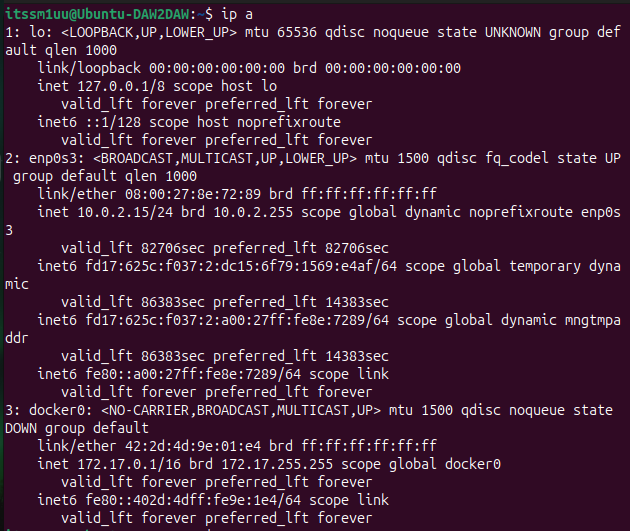

## 1.2. Servidor web Apache: historia y funcionamiento

**Apache HTTP Server** es un servidor web gratuito y de código abierto que permite alojar páginas y aplicaciones web para que los usuarios puedan acceder a ellas desde un navegador.

Su primera versión apareció en 1995 y, desde entonces, se ha convertido en uno de los servidores web más conocidos. Está desarrollado y mantenido por la *Apache Software Foundation*.

Una de sus características principales es que funciona mediante módulos. Esto permite añadir o configurar distintas funcionalidades según las necesidades del servidor. Por ejemplo, `mod_rewrite` permite modificar o redirigir direcciones URL y `mod_ssl` permite configurar conexiones seguras mediante HTTPS.

Apache recibe las peticiones que realizan los usuarios desde sus navegadores, las procesa y devuelve el contenido solicitado. Habitualmente utiliza el puerto 80 para HTTP y el puerto 443 para HTTPS.

## 1.3. Alternativas a Apache

Aunque Apache es uno de los servidores web más conocidos, existen otras alternativas que se utilizan dependiendo de las necesidades de cada proyecto:

- **Nginx:** destaca por su rendimiento y su bajo consumo de recursos. Está preparado para gestionar muchas conexiones al mismo tiempo y servir archivos estáticos de forma eficiente.
- **LiteSpeed:** es un servidor web comercial que puede utilizarse como alternativa a Apache. Una de sus características es la compatibilidad con archivos `.htaccess`, lo que facilita la adaptación de determinadas configuraciones.
- **Caddy:** es un servidor web moderno desarrollado en Go. Se caracteriza por su configuración sencilla y por facilitar la gestión automática de certificados SSL/TLS para utilizar HTTPS.

## 1.4. Objetivo de la práctica

El objetivo de esta práctica es aprender a instalar, configurar y administrar un servidor web Apache en un sistema Linux.

Durante el desarrollo se trabajan conceptos como la instalación de servicios, la gestión de permisos y directorios, la configuración de VirtualHosts y el control de acceso a determinadas partes de una página web.

Además, las pruebas permiten comprobar cómo un servidor puede recibir peticiones de otros equipos conectados a la misma red y responder mostrando el contenido solicitado.

---

# 2. Desarrollo de la práctica

## 2.1. Preparación e instalación de Apache2

Antes de instalar Apache, se actualizan los repositorios y los paquetes del sistema para evitar trabajar con información desactualizada.

**1. Actualización del sistema**

Se ejecutan los siguientes comandos:

```bash
sudo apt update && sudo apt upgrade -y
```

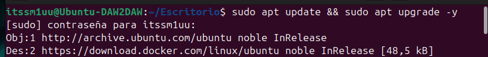

**2. Instalación de Apache2**

A continuación, se instala Apache2 junto con las utilidades adicionales mediante el gestor de paquetes `apt`:

```bash
sudo apt install apache2 apache2-utils -y
```

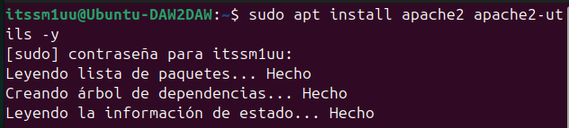

**3. Comprobación del servicio**

Una vez terminada la instalación, se comprueba que el servicio se encuentra activo:

```bash
sudo systemctl status apache2
```

Si el servicio no está iniciado, se puede iniciar y configurar para que arranque automáticamente con el sistema mediante:

```bash
sudo systemctl enable --now apache2
```

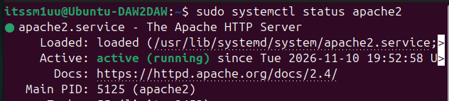

## 2.2. Creación de la página web personalizada

Después de instalar Apache, se crea una página web propia para sustituir la página de bienvenida que aparece por defecto.

**1. Creación del directorio**

Se crea el directorio donde se guardarán los archivos del sitio web:

```bash
sudo mkdir -p /var/www/mi_sitio_web
```

**2. Creación del archivo `index.html`**

Se utiliza el editor de texto `nano` para crear el archivo principal:

```bash
sudo nano /var/www/mi_sitio_web/index.html
```

En este archivo se añade el código HTML y CSS de la página personalizada.

El código completo se encuentra en el archivo [index.html](html/index.html).


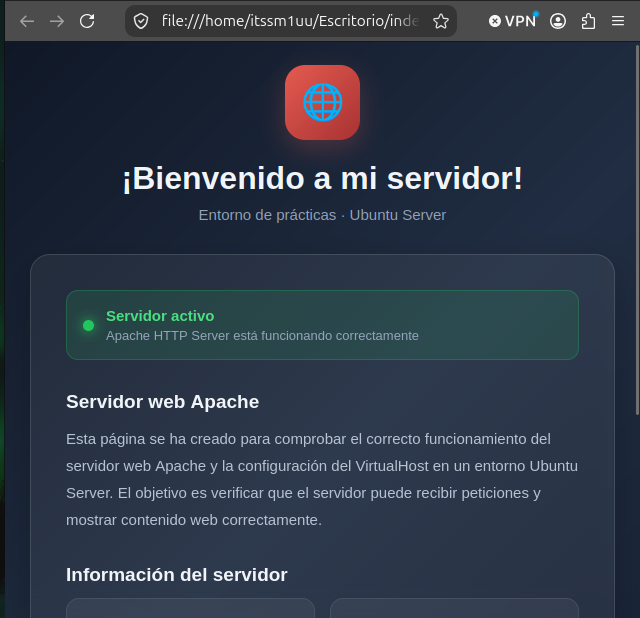

## 2.3. Configuración del VirtualHost

Una vez creada la página, se configura Apache para que utilice el directorio del nuevo sitio web. Para ello, se crea un VirtualHost, que permite definir la configuración de un sitio de forma independiente.

### 2.3.1. Asignación de permisos al directorio

Primero, se asigna la propiedad del directorio al usuario actual:

```bash
sudo chown -R $USER:$USER /var/www/mi_sitio_web
```

Después, se establecen permisos de lectura y ejecución para que Apache pueda acceder a los archivos:

```bash
sudo chmod -R 755 /var/www/mi_sitio_web
```

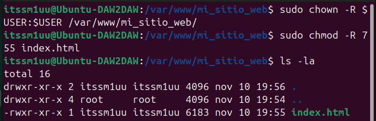

### 2.3.2. Creación del archivo de configuración

Se crea un archivo específico para el nuevo sitio dentro del directorio `sites-available`:

```bash
sudo nano /etc/apache2/sites-available/mi_sitio_web.conf
```

En su interior se añade la siguiente configuración:

```apache
<VirtualHost *:80>
    ServerAdmin webmaster@localhost
    ServerName mi_sitio_web.local
    ServerAlias www.mi_sitio_web.local
    DocumentRoot /var/www/mi_sitio_web

    <Directory /var/www/mi_sitio_web>
        Options Indexes FollowSymLinks
        AllowOverride All
        Require all granted
    </Directory>

    ErrorLog ${APACHE_LOG_DIR}/mi_sitio_error.log
    CustomLog ${APACHE_LOG_DIR}/mi_sitio_access.log combined
</VirtualHost>
```

Con esta configuración se indica que el sitio escucha en el puerto 80, que su nombre es `mi_sitio_web.local` y que los archivos de la página se encuentran en `/var/www/mi_sitio_web`.

La directiva `AllowOverride All` permite que Apache tenga en cuenta las reglas definidas en archivos `.htaccess` dentro de ese directorio.

**[CAPTURA 8 — Archivo `mi_sitio_web.conf` mostrando la configuración del VirtualHost.]**

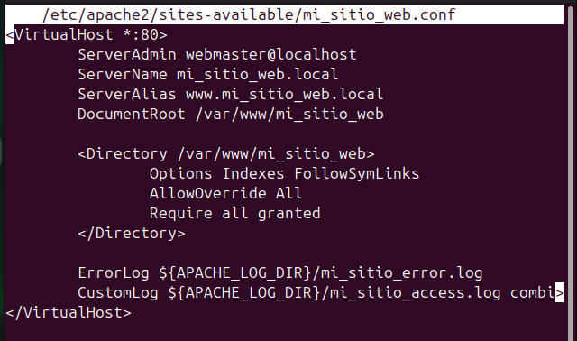

### 2.3.3. Activación del sitio y comprobación de la configuración

Primero, se desactiva el sitio predeterminado y se activa el nuevo VirtualHost:

```bash
sudo a2dissite 000-default.conf
sudo a2ensite mi_sitio_web.conf
```

A continuación, se comprueba que no haya errores en la configuración:

```bash
sudo apache2ctl configtest
```

El resultado esperado es:

```text
Syntax OK
```

Por último, se recarga Apache para aplicar los cambios:

```bash
sudo systemctl reload apache2
```

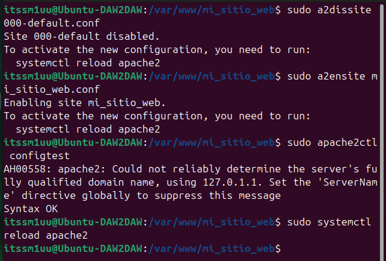


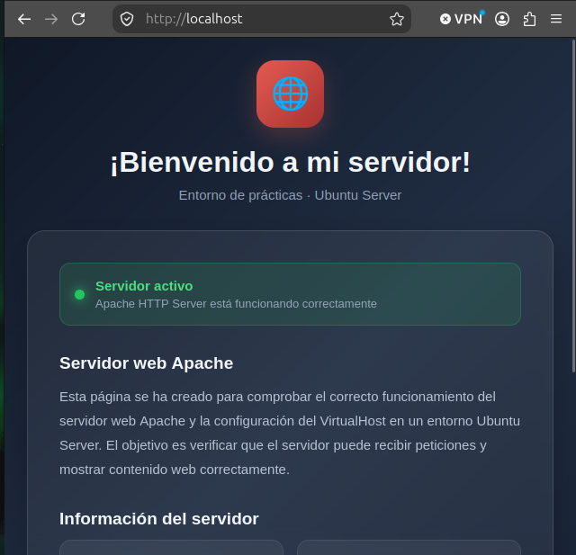


## 2.4. Protección de un directorio mediante `.htaccess`

Como configuración adicional, se crea una zona privada dentro del sitio web. El objetivo es impedir que cualquier visitante pueda acceder a su contenido sin introducir unas credenciales válidas.

**1. Creación del directorio privado**

Se crea una carpeta llamada `privado` dentro del directorio principal:

```bash
sudo mkdir -p /var/www/mi_sitio_web/privado
```

También se crea una página HTML sencilla para comprobar el funcionamiento de la protección:

```bash
echo "<h1>Área Restringida</h1><p>Bienvenido al panel privado.</p>" | sudo tee /var/www/mi_sitio_web/privado/index.html
```

**2. Creación del archivo de contraseñas**

Se utiliza la herramienta `htpasswd` para crear un archivo donde se almacenan las contraseñas protegidas del usuario autorizado:

```bash
sudo htpasswd -c /etc/apache2/.htpasswd usuario_admin
```

El sistema solicita introducir y confirmar la contraseña. Esta contraseña no debe incluirse en la memoria ni en las capturas.

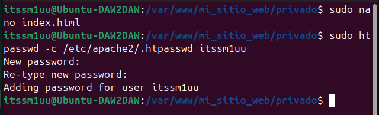

**3. Creación del archivo `.htaccess`**

Dentro del directorio privado se crea el archivo `.htaccess`:

```bash
sudo nano /var/www/mi_sitio_web/privado/.htaccess
```

Se añade la siguiente configuración:

```apache
AuthType Basic
AuthName "Acceso Restringido"
AuthUserFile /etc/apache2/.htpasswd
Require valid-user
```

Estas directivas indican que se utilizará autenticación básica, que Apache debe consultar el archivo `.htpasswd` y que solo podrán entrar los usuarios autorizados.


---

# 3. Pruebas y comprobaciones

Una vez terminada la configuración, se realizan varias pruebas para comprobar que Apache sirve la página correctamente y que el directorio privado está protegido.

## 3.1. Comprobaciones desde el servidor

**1. Comprobación de la respuesta HTTP**

Se utiliza el comando `curl` para realizar una petición al servidor local y consultar las cabeceras de la respuesta:

```bash
curl -I http://localhost
```

En la prueba realizada se obtuvo una respuesta `HTTP/1.1 200 OK`, que indica que la petición se atendió correctamente.

Resultado obtenido:

```text
HTTP/1.1 200 OK
Date: [fecha y hora de la prueba]
Server: Apache/2.4.52 (Ubuntu)
Content-Type: text/html
```

**2. Prueba de acceso al directorio privado**

Primero, se intenta acceder sin introducir credenciales:

```bash
curl -I http://localhost/privado/
```

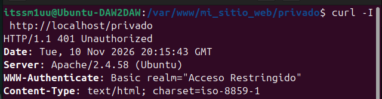

El resultado esperado es `401 Unauthorized`, ya que el acceso está protegido.

Después, se realiza una petición con el usuario y la contraseña correctos:

```bash
curl -I -u usuario_admin http://localhost/privado/
```

En este caso, `curl` solicitará la contraseña de forma interactiva. Si las credenciales son correctas, el servidor debería devolver `200 OK`.


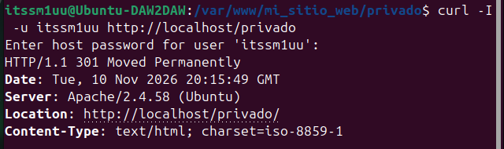


# 4. Resultados y conclusiones

## 4.1. Resultados obtenidos

Al finalizar la práctica se ha conseguido instalar y poner en funcionamiento Apache2 en Ubuntu Server. También se ha creado una página web personalizada y se ha configurado un VirtualHost para indicar desde qué directorio debe servirse su contenido.

Además, se ha creado un directorio privado protegido mediante autenticación básica con `.htaccess`. Las pruebas realizadas permiten comprobar si la página principal responde correctamente y si el acceso al directorio privado queda limitado a los usuarios autorizados.


## 4.2. Problemas encontrados

Durante la práctica pueden aparecer algunos problemas relacionados con los permisos de los directorios o con la configuración de Apache. En este apartado se deben describir únicamente los inconvenientes que hayan ocurrido realmente.

Por ejemplo, si se produjo un error `403 Forbidden`, se debe indicar en qué momento apareció, cuál fue la causa que se comprobó y qué cambio permitió solucionarlo.

También puede ser necesario revisar la directiva `AllowOverride` del VirtualHost. Si está configurada como `None`, Apache no aplicará las reglas definidas en los archivos `.htaccess`. Para permitirlas en el directorio del sitio se puede utilizar:

```apache
AllowOverride All
```

## 4.3. Valoración personal

La realización de esta práctica ha permitido conocer mejor el funcionamiento de un servidor web y los pasos necesarios para ponerlo en marcha desde Ubuntu Server.

Al principio, algunos conceptos como los permisos de los directorios, la configuración del VirtualHost o el funcionamiento de los archivos `.htaccess` pueden resultar algo confusos. Sin embargo, al ir configurándolos y realizando las pruebas, resulta más sencillo entender para qué sirve cada uno.

En general, la práctica ha sido útil para poner en práctica los conocimientos del módulo y comprender cómo se puede publicar una página web para que otros equipos de la misma red puedan acceder a ella.

---

# 5. Bibliografía

- Canonical Ltd. (s. f.). *Install and configure Apache*. Ubuntu Tutorials. https://ubuntu.com/tutorials/install-and-configure-apache
- The Apache Software Foundation. *Apache HTTP Server Version 2.4 Documentation*. https://httpd.apache.org/docs/2.4/
- Mozilla Developer Network (MDN). *HTTP authentication*. https://developer.mozilla.org/es/docs/Web/HTTP/Authentication

---

# 6. Anexos

## Anexo A. Comandos para consultar los registros de Apache

Apache guarda registros que permiten consultar las peticiones recibidas y los errores que se producen. Para ver los accesos en tiempo real se puede utilizar:

```bash
sudo tail -f /var/log/apache2/mi_sitio_access.log
```

Para consultar los errores del servidor:

```bash
sudo tail -f /var/log/apache2/mi_sitio_error.log
```

Estos comandos permiten observar la actividad del servidor y pueden resultar útiles para localizar problemas durante las pruebas.

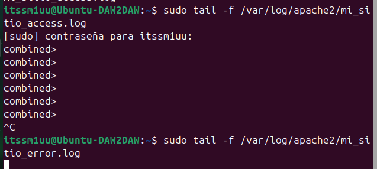
