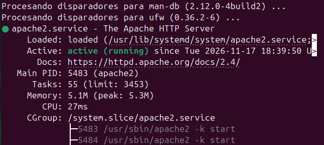
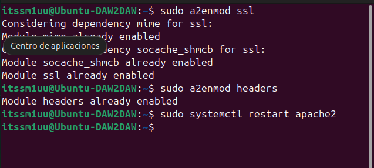
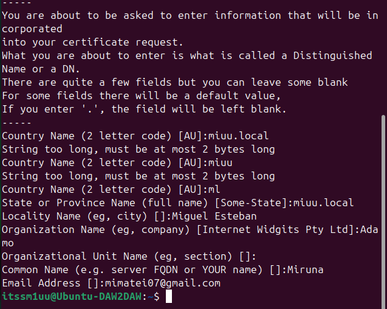
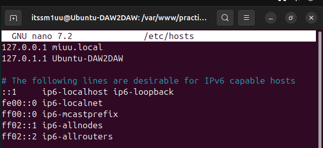
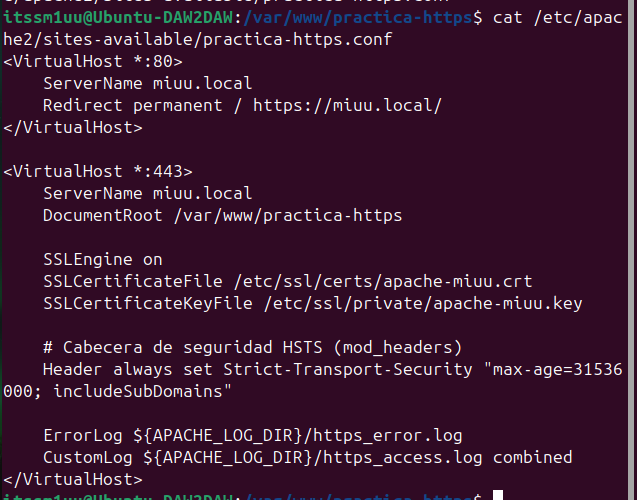
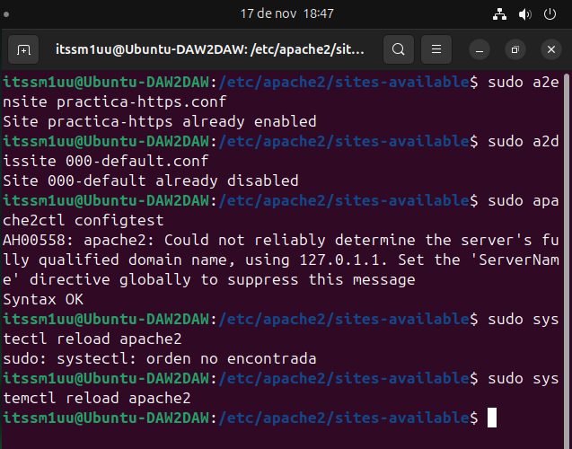
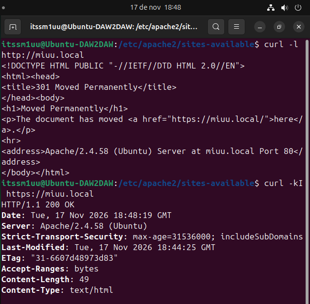
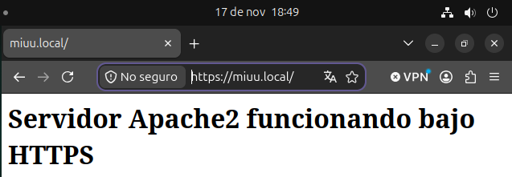

# Práctica: Implementación de HTTPS y Certificados SSL/TLS en Apache2 (Ubuntu)
 
**Autora:** Miruna Georgiana Matei (Miuu)  
**Sistema Operativo:** Ubuntu 24.04 LTS  
**Servicio:** Apache2  
 
---
 
## 1. Investigación Teórica
 
### 1.1. Funcionamiento del protocolo HTTPS e importancia
 
HTTPS (*Hypertext Transfer Protocol Secure*) es la versión segura de HTTP. Utiliza el protocolo criptográfico **TLS** (*Transport Layer Security*) para cifrar las comunicaciones entre el cliente (navegador) y el servidor web.
 
El proceso ocurre mediante un **TLS Handshake** antes de transmitir datos HTTP:
 
1. El cliente solicita una conexión segura y envía las versiones de TLS y algoritmos de cifrado que soporta.
2. El servidor responde enviando su **certificado digital** (que contiene su clave pública).
3. El cliente verifica la validez del certificado y genera una clave de sesión simétrica, la cual cifra usando la clave pública del servidor.
4. El servidor descifra esa clave con su clave privada y, a partir de ese momento, todo el tráfico viaja cifrado simétricamente.
 
### 1.2. Tipos de certificados SSL/TLS: Autofirmados vs. CA Confiable
 
| Característica | Certificado Autofirmado (*Self-Signed*) | Certificado emitido por una CA Confiable |
| :--- | :--- | :--- |
| **Emisor** | El propio administrador del servidor mediante herramientas como `openssl`. | Una Autoridad Certificadora reconocida (Let's Encrypt, DigiCert, Sectigo). |
| **Confianza en navegadores** | **No confiable por defecto.** Muestra una alerta de seguridad al usuario porque no hay un tercero que respalde la identidad. | **Confiable automáticamente.** Los navegadores y SO traen preinstalados los certificados raíz de estas CAs. |
| **Coste y emisión** | Gratuito e instantáneo; no requiere dominio público. | Gratuito (ej. Let's Encrypt) o de pago; requiere validar la propiedad de un dominio público. |
| **Uso recomendado** | Entornos de desarrollo, pruebas en local e intranets. | Sitios web y aplicaciones en producción accesibles desde Internet. |
 
### 1.3. Módulos de Apache2 necesarios en Ubuntu
 
Para soportar HTTPS y reforzar la seguridad de las cabeceras HTTP en Ubuntu, Apache2 requiere habilitar:
 
* **`mod_ssl` (`ssl`):** Proporciona soporte para los protocolos SSL/TLS, permitiendo gestionar certificados, claves privadas y escuchar peticiones cifradas en el puerto 443.
* **`mod_headers` (`headers`):** Permite modificar y añadir cabeceras HTTP de petición y respuesta. Es indispensable para implementar medidas de seguridad adicionales como **HSTS** (*HTTP Strict Transport Security*), que obliga a los navegadores a conectarse siempre mediante HTTPS.
* **`mod_rewrite` (`rewrite`):** Opcional si se usa la directiva `Redirect`, pero muy habitual para redirigir dinámicamente el tráfico del puerto 80 al 443.
---
 
## 2. Ejecución Técnica Paso a Paso
 
### Paso 1: Instalación y verificación de Apache2
 
Actualizamos los repositorios, instalamos el servidor web y comprobamos que el servicio esté activo y corriendo:
 
```bash
sudo apt update && sudo apt install apache2 -y
sudo systemctl status apache2
```


 
Si el firewall `ufw` está activo, permitimos el tráfico tanto HTTP (80) como HTTPS (443) mediante el perfil completo de Apache:
 
```bash
sudo ufw allow 'Apache Full'
sudo ufw status
```
 
### Paso 2: Habilitación de los módulos SSL y Headers
 
Activamos los módulos necesarios usando la utilidad `a2enmod` y reiniciamos el servicio para aplicar los cambios:
 
```bash
sudo a2enmod ssl
sudo a2enmod **headers**
sudo systemctl restart apache2
```
 

 
### Paso 3: Generación del certificado SSL/TLS autofirmado (Opción A)
 
Creamos un par de clave privada y certificado X.509 válido por 365 días usando `openssl`. Guardamos la clave en `/etc/ssl/private/` (con permisos restringidos) y el certificado público en `/etc/ssl/certs/`:
 
```bash
sudo openssl req -x509 -nodes -days 365 -newkey rsa:2048 \
  -keyout /etc/ssl/private/apache-miuu.key \
  -out /etc/ssl/certs/apache-miuu.crt
```
 
Durante la generación, se rellenan los datos identificativos del certificado, destacando el **Common Name (CN)** donde indicamos nuestro dominio de pruebas (`miuu.local`).
 

 
### Paso 4: Preparación del sitio web y resolución local
 
Creamos el directorio del sitio, un archivo `index.html` de prueba y añadimos el dominio local al archivo `/etc/hosts` para poder resolverlo desde el navegador:
 
```bash
sudo mkdir -p /var/www/practica-https
echo "<h1>Servidor Apache2 funcionando bajo HTTPS</h1>" | sudo tee /var/www/practica-https/index.html
sudo chown -R www-data:www-data /var/www/practica-https
```
 
En `/etc/hosts` añadimos la línea:
 
```plaintext
127.0.0.1   miuu.local
```


 
### Paso 5: Configuración del VirtualHost (Puerto 443 y Redirección HTTP → HTTPS)
 
Creamos el archivo de configuración `/etc/apache2/sites-available/practica-https.conf`. En él definimos dos bloques: uno en el puerto 80 que redirige todo el tráfico hacia HTTPS, y otro en el puerto 443 con el motor SSL activo, las rutas a nuestros certificados y la cabecera HSTS:
 
```apache
<VirtualHost *:80>
    ServerName miuu.local
    Redirect permanent / https://miuu.local/
</VirtualHost>
 
<VirtualHost *:443>
    ServerName miuu.local
    DocumentRoot /var/www/practica-https
 
    SSLEngine on
    SSLCertificateFile /etc/ssl/certs/apache-miuu.crt
    SSLCertificateKeyFile /etc/ssl/private/apache-miuu.key
 
    # Cabecera de seguridad HSTS (mod_headers)
    Header always set Strict-Transport-Security "max-age=31536000; includeSubDomains"
 
    ErrorLog ${APACHE_LOG_DIR}/https_error.log
    CustomLog ${APACHE_LOG_DIR}/https_access.log combined
</VirtualHost>
```
 

 
### Paso 6: Activación del sitio y recarga de Apache
 
Habilitamos el nuevo VirtualHost, deshabilitamos el sitio por defecto para evitar conflictos, comprobamos que la sintaxis sea correcta (`apache2ctl configtest`) y recargamos Apache:
 
```bash
sudo a2ensite practica-https.conf
sudo a2dissite 000-default.conf
sudo apache2ctl configtest
sudo systemctl reload apache2
```
 

 
---
 
## 3. Verificación y Resultados
 
### 3.1. Comprobación mediante terminal (curl)
 
Verificamos tanto la redirección `301 Moved Permanently` desde HTTP como la respuesta HTTPS (usando `-k` para aceptar el certificado autofirmado y `-I` para ver las cabeceras, incluida `Strict-Transport-Security`):
 
```bash
curl -I http://miuu.local
curl -kI https://miuu.local
```
 

 
### 3.2. Comprobación en el navegador web
 
Al acceder a `http://miuu.local`, el navegador redirige automáticamente a `https://miuu.local`. Inicialmente aparece la advertencia de seguridad habitual al tratarse de un certificado autofirmado no respaldado por una CA externa. Tras aceptar el riesgo y continuar, se carga la página correctamente.

 

 
---
 
## 4. Conclusiones y Dificultades Encontradas
 
* **Conclusión general:** La implementación de HTTPS en Apache2 sobre Ubuntu es un proceso directo gracias a las utilidades nativas como `a2enmod` y `a2ensite`. Combinar `mod_ssl` con `mod_headers` (HSTS) y una redirección permanente desde el puerto 80 asegura que ningún usuario navegue en texto plano por error.
* **Dificultades encontradas:**
  * **Advertencia en el navegador:** Al trabajar en un entorno local sin dominio público, no fue viable utilizar Certbot/Let's Encrypt, por lo que se optó por un certificado autofirmado. Esto provoca que los navegadores marquen la conexión como "No segura" hasta añadir una excepción manual, demostrando en la práctica el papel fundamental de las Autoridades Certificadoras en producción.
  * **Permisos y firewall:** Fue necesario asegurarse de que la clave privada (`.key`) permaneciera protegida en `/etc/ssl/private/` con acceso exclusivo para `root`, y comprobar que el cortafuegos permitiera el tráfico entrante por el puerto 443 además del 80.
 
