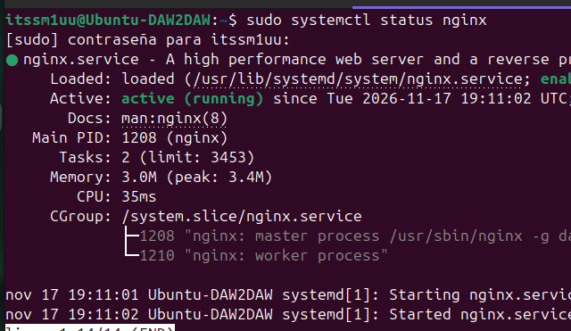
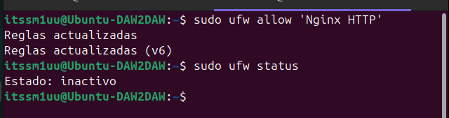
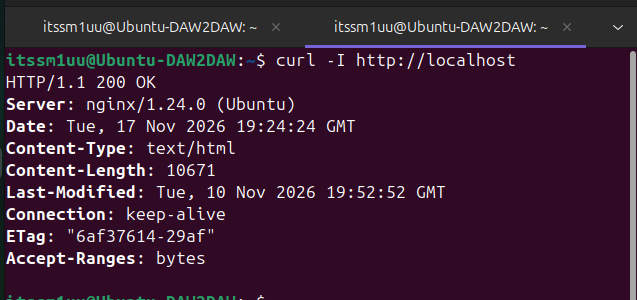
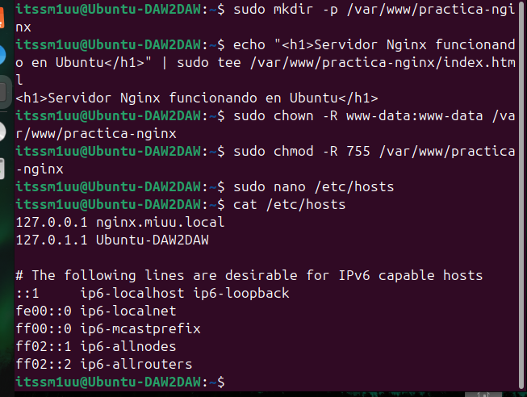
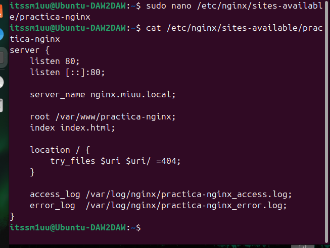
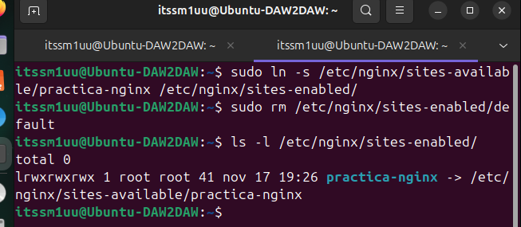
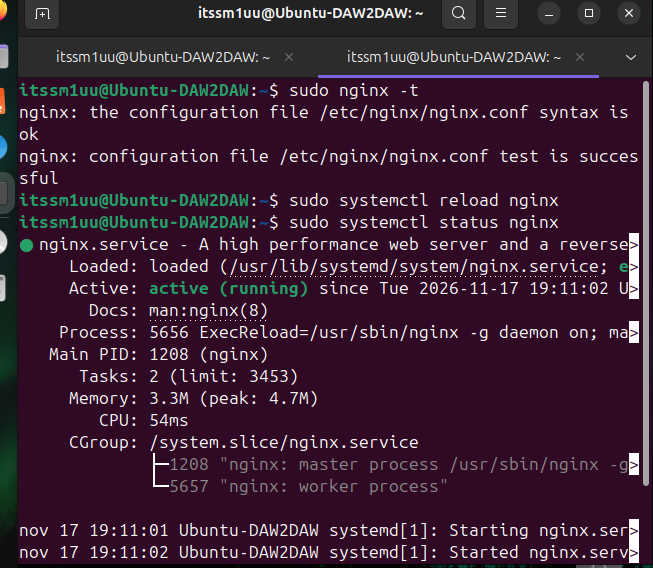
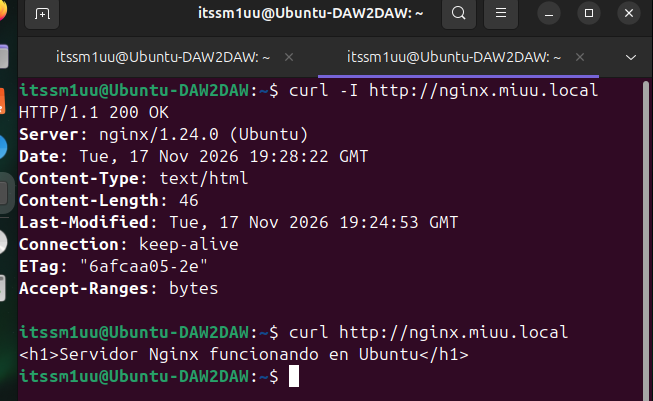
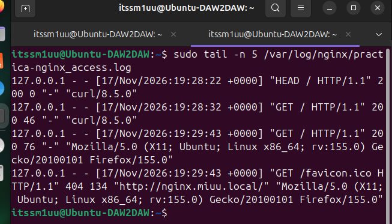

# Práctica: Instalación y Configuración de un Servidor Web Nginx en Ubuntu
 
**Autora:** Miruna Georgiana Matei (Miuu)  
**Sistema Operativo:** Ubuntu 24.04 LTS  
**Servicio:** Nginx  
 
---
 
## 1. Investigación Teórica
 
### 1.1. ¿Qué es Nginx?
 
**Nginx** (pronunciado *"engine-x"*) es un servidor web de código abierto que también funciona como **proxy inverso**, **balanceador de carga**, **caché HTTP** y proxy de correo. Fue creado por Igor Sysoev y publicado en 2004 para resolver el llamado *problema C10K*: atender más de 10.000 conexiones simultáneas con un consumo reducido de recursos.
 
Los servidores clásicos son como contratar 1 camarero por cada cliente: si entran 1.000 personas, necesitas 1.000 camareros y te quedas sin espacio (sin memoria RAM), aunque muchos clientes solo estén mirando la carta sin hacer nada.

Este sistema (asíncrono y por eventos) es tener 4 camareros súper rápidos (workers) que van saltando de mesa en mesa atendiendo solo cuando alguien ya sabe qué pedir o cuando un café ya está listo.
 
### 1.2. Diferencias principales entre Nginx y Apache
 
| Característica | Nginx | Apache HTTP Server |
| :--- | :--- | :--- |
| **Arquitectura** | Asíncrona y orientada a eventos; pocos procesos *worker* atienden muchas conexiones. | Basada en procesos/hilos (MPM `prefork`, `worker` o `event`); históricamente un proceso o hilo por conexión. |
| **Consumo de recursos** | Bajo y estable incluso con mucho tráfico concurrente. | Mayor consumo de memoria al aumentar las conexiones (sobre todo con `prefork`). |
| **Contenido estático** | Muy eficiente. | Correcto, pero generalmente algo más lento que Nginx. |
| **Contenido dinámico** | No lo procesa por sí mismo; delega en procesadores externos (PHP-FPM, FastCGI, proxy a otra aplicación). | Puede procesarlo mediante módulos integrados (por ejemplo, `mod_php`). |
| **Configuración** | Un único árbol de configuración con bloques `server { }` y `location { }`. **No** admite ficheros `.htaccess`. | Configuración central más archivos `.htaccess` por directorio, que permiten cambios sin reiniciar. |
| **Módulos** | La mayoría de módulos se compilan en el binario (los dinámicos existen desde la versión 1.9.11). | Sistema de módulos dinámicos muy amplio, que se activa con `a2enmod`. |
| **Hosts virtuales** | Se llaman **server blocks** (`server { }`). | Se llaman **VirtualHost** (`<VirtualHost>`). |
| **Uso típico** | Proxy inverso, balanceo de carga, alto tráfico, servidor de estáticos. | Alojamiento compartido, aplicaciones que dependen de `.htaccess` y módulos. |

 
### 1.3. Cómo instalar y ejecutar Nginx en Ubuntu
 
Nginx está disponible en los repositorios oficiales de Ubuntu, por lo que se instala con `apt`. Los puntos clave son:
 
* **Instalación:** `sudo apt install nginx`.
* **Gestión del servicio:** se controla con `systemctl` (`start`, `stop`, `restart`, `reload`, `status`, `enable`). Tras instalarlo, el servicio arranca automáticamente.
* **Cortafuegos:** si `ufw` está activo, se debe permitir el tráfico con perfiles como `Nginx HTTP` (puerto 80) o `Nginx Full` (80 y 443).
* **Estructura de directorios en Ubuntu:**
| Ruta | Función |
| :--- | :--- |
| `/etc/nginx/nginx.conf` | Configuración global. |
| `/etc/nginx/sites-available/` | Configuraciones de cada sitio (disponibles). |
| `/etc/nginx/sites-enabled/` | Enlaces simbólicos a los sitios activos. |
| `/var/www/html/` | Directorio raíz por defecto. |
| `/var/log/nginx/` | Registros `access.log` y `error.log`. |
 
* **Validación:** `sudo nginx -t` comprueba la sintaxis antes de aplicar cambios, y `sudo systemctl reload nginx` los aplica sin cortar las conexiones activas.
---
 
## 2. Ejecución Técnica Paso a Paso
 
### Paso 1: Instalación de Nginx
 
Actualizamos los repositorios, instalamos Nginx y comprobamos que el servicio esté activo:
 
```bash
sudo apt update
sudo apt install nginx -y
sudo systemctl status nginx
nginx -v
```
 

 
Si el firewall `ufw` está activo, permitimos el tráfico web:
 
```bash
sudo ufw allow 'Nginx HTTP'
sudo ufw status
```
 

 
### Paso 2: Comprobación de la página por defecto
 
Verificamos que Nginx responde correctamente antes de modificar nada:
 
```bash
curl -I http://localhost
```
 

 
### Paso 3: Preparación del sitio web
 
Creamos el directorio del sitio, una página `index.html` de prueba y asignamos los permisos al usuario con el que se ejecuta Nginx (`www-data`):
 
```bash
sudo mkdir -p /var/www/practica-nginx
echo "<h1>Servidor Nginx funcionando en Ubuntu</h1>" | sudo tee /var/www/practica-nginx/index.html
sudo chown -R www-data:www-data /var/www/practica-nginx
sudo chmod -R 755 /var/www/practica-nginx
```
 
Para poder acceder por nombre desde el navegador, añadimos el dominio local en `/etc/hosts`:
 
```plaintext
127.0.0.1   nginx.miuu.local
```
 

 
### Paso 4: Configuración del Servidor (Bloque *server*)
 
Creamos el archivo `/etc/nginx/sites-available/practica-nginx` con el siguiente contenido:
 
```nginx
server {
    listen 80;
    listen [::]:80;
 
    server_name nginx.miuu.local;
 
    root /var/www/practica-nginx;
    index index.html;
 
    location / {
        try_files $uri $uri/ =404;
    }
 
    access_log /var/log/nginx/practica-nginx_access.log;
    error_log  /var/log/nginx/practica-nginx_error.log;
}
```
 
Explicación de las directivas principales:
 
* **`listen`**: puerto (y protocolo IPv4/IPv6) en el que escucha el bloque.
* **`server_name`**: nombre de dominio al que responde este bloque.
* **`root`**: directorio del que se sirven los archivos.
* **`index`**: archivo que se muestra por defecto.
* **`location /`**: define cómo se tratan las peticiones; `try_files` devuelve un error 404 si el recurso no existe.
* **`access_log` / `error_log`**: ficheros de registro propios del sitio.


 
### Paso 5: Activación del sitio
 
En Ubuntu, un sitio se activa creando un enlace simbólico desde `sites-available` a `sites-enabled`. Además, eliminamos el sitio por defecto para evitar conflictos:
 
```bash
sudo ln -s /etc/nginx/sites-available/practica-nginx /etc/nginx/sites-enabled/
sudo rm /etc/nginx/sites-enabled/default
ls -l /etc/nginx/sites-enabled/
```
 

 
### Paso 6: Validación y aplicación de cambios
 
Comprobamos que la sintaxis de la configuración es correcta y, solo entonces, recargamos el servicio:
 
```bash
sudo nginx -t
sudo systemctl reload nginx
sudo systemctl status nginx
```
 

 
---
 
## 3. Verificación y Resultados
 
### 3.1. Comprobación mediante terminal (curl)
 
```bash
curl -I http://nginx.miuu.local
curl http://nginx.miuu.local
```
 
Esperamos un `HTTP/1.1 200 OK` con la cabecera `Server: nginx` y el contenido HTML que hemos creado.
 

 
### 3.2. Comprobación en el navegador web
 
Accedemos a `http://nginx.miuu.local` desde el navegador y comprobamos que se muestra la página personalizada en lugar de la página por defecto de Nginx.
 

 
### 3.3. Revisión de los registros
 
Comprobamos que las peticiones quedan registradas en los logs propios del sitio:
 
```bash
sudo tail -n 5 /var/log/nginx/practica-nginx_access.log
```
 

 
---
 
## 4. Conclusiones y Dificultades Encontradas
 
* **Conclusión general:** Nginx es muy sencillo de instalar y configurar en Ubuntu. Su modelo de *server blocks* es claro y fácil de leer, y la separación entre `sites-available` y `sites-enabled` permite activar o desactivar sitios con un simple enlace simbólico. El comando `nginx -t` evita errores al permitir validar la configuración antes de aplicarla.
* **Comparación con Apache:** el flujo de trabajo es muy parecido (crear el sitio, activarlo, validar y recargar), pero en Nginx se activa con `ln -s` en lugar de `a2ensite`, no existen `.htaccess` y la configuración es más compacta. Para contenido dinámico necesita un procesador externo, mientras que Apache puede gestionarlo con módulos propios.
* **Dificultades encontradas:**
  * **Conflicto con el sitio por defecto:** mantener activo el archivo `default` junto al nuevo bloque puede provocar que se sirva la página equivocada, por lo que se eliminó el enlace de `sites-enabled`.
  * **Puerto 80 ocupado:** si Apache2 sigue en ejecución en la misma máquina, Nginx no puede enlazar el puerto 80. Hay que detener Apache (`sudo systemctl stop apache2`) o cambiar el puerto de uno de los dos servidores.
  * **Permisos del directorio:** el usuario `www-data` debe poder leer el directorio del sitio; de lo contrario, Nginx devuelve un error `403 Forbidden`.
  * **Resolución del nombre:** al no disponer de un DNS, fue necesario añadir el dominio en `/etc/hosts` para acceder por nombre.
 
