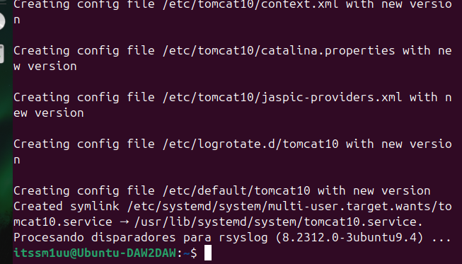
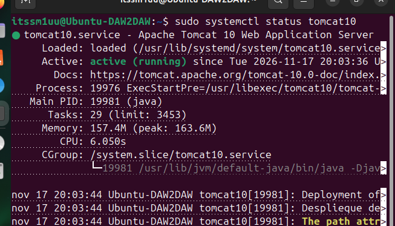
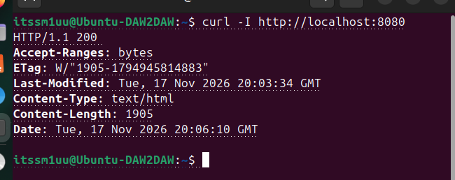
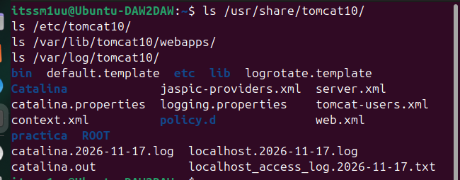
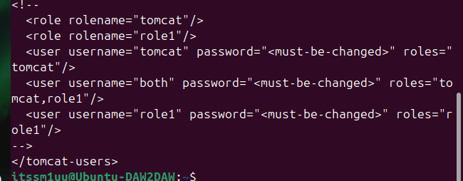
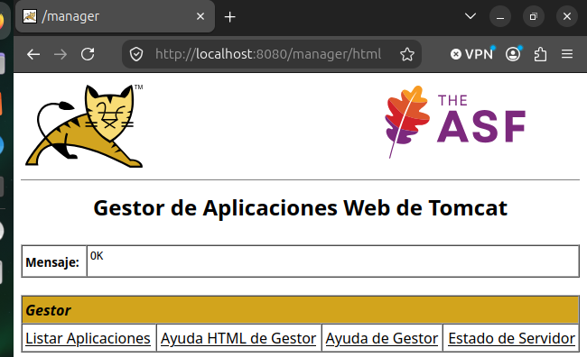
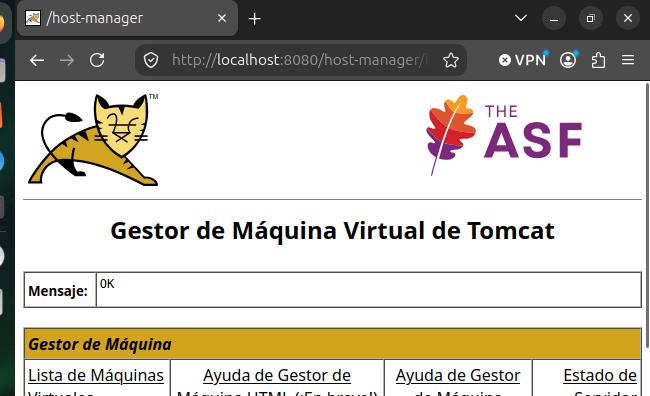
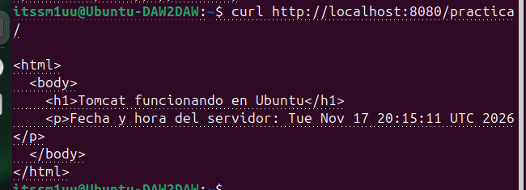
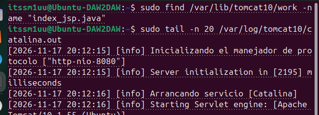

# Práctica: Arquitectura e Instalación de Apache Tomcat en Ubuntu
 
**Autora:** Miruna Georgiana Matei (Miuu)  
**Sistema Operativo:** Ubuntu 24.04 LTS  
**Servicio:** Apache Tomcat 10.1 (paquete `tomcat10`)  
 
---
 
## 1. Investigación Teórica
 
### 1.1. ¿Qué es Apache Tomcat?
 
**Apache Tomcat** es un servidor de aplicaciones de código abierto que implementa las especificaciones de **Jakarta Servlet**, **Jakarta Server Pages (JSP)** y otras tecnologías web de Jakarta EE. Actúa como **contenedor de servlets**: recibe peticiones HTTP, ejecuta código Java en el servidor y devuelve la respuesta al cliente. También puede servir contenido estático, aunque su función principal es ejecutar aplicaciones web Java.
 
### 1.2. Componentes principales
 
| Componente | Función |
| :--- | :--- |
| **Coyote** | Conector HTTP/HTTPS. Escucha en la red (por defecto en el puerto `8080`), recibe las peticiones y las entrega al motor. |
| **Catalina** | Contenedor de servlets. Gestiona el ciclo de vida de las aplicaciones y ejecuta la lógica. Se organiza de forma jerárquica: *Server* → *Service* → *Engine* → *Host* → *Context*. |
| **Jasper** | Motor de JSP. Traduce las páginas `.jsp` a servlets Java, las compila y las mantiene actualizadas cuando cambian. |
| **Manager** | Aplicación web integrada para desplegar, iniciar, detener y recargar aplicaciones desde el navegador. |
| **Host Manager** | Aplicación web integrada para crear y gestionar *virtual hosts* en tiempo de ejecución. |
 
### 1.3. Flujo de una petición
 
1. **Coyote** recibe la petición HTTP desde el cliente.
2. La entrega al motor de **Catalina**, que la dirige por la jerarquía *Engine* → *Host* → *Context* hasta la aplicación y el servlet adecuados.
3. Si el recurso es una página **JSP**, **Jasper** la traduce a un servlet Java y la compila (solo la primera vez o cuando cambia).
4. El servlet genera la respuesta, que vuelve por Catalina y Coyote hasta el cliente.
### 1.4. Estructura de directorios en Ubuntu (instalación con `apt`)
 
Con el paquete de Ubuntu, `CATALINA_HOME` (binarios) y `CATALINA_BASE` (configuración y datos) están separados:
 
| Directorio | Contenido | Ruta |
| :--- | :--- | :--- |
| `bin/` y `lib/` | Binarios y librerías compartidas del motor | `/usr/share/tomcat10/bin` y `/usr/share/tomcat10/lib` |
| `conf/` | Configuración (`server.xml`, `tomcat-users.xml`) | `/etc/tomcat10` (enlazado en `/var/lib/tomcat10/conf`) |
| `webapps/` | Aplicaciones (`.war` y carpetas), incluidas `manager` y `host-manager` | `/var/lib/tomcat10/webapps` |
| `work/` | Código generado por Jasper (servlets compilados de los JSP) | `/var/lib/tomcat10/work` |
| `logs/` | Registros, como `catalina.out` | `/var/log/tomcat10` |
 
### 1.5. Fuentes consultadas
 
Documentación oficial de Apache Tomcat 10.1:
 
* Architecture Overview: <https://tomcat.apache.org/tomcat-10.1-doc/architecture/overview.html>
* Request Process Flow: <https://tomcat.apache.org/tomcat-10.1-doc/architecture/requestProcess.html>
* The HTTP Connector: <https://tomcat.apache.org/tomcat-10.1-doc/config/http.html>
* Jasper 2 JSP Engine How-To: <https://tomcat.apache.org/tomcat-10.1-doc/jasper-howto.html>
* Manager App How-To: <https://tomcat.apache.org/tomcat-10.1-doc/manager-howto.html>
* Host Manager App How-To: <https://tomcat.apache.org/tomcat-10.1-doc/host-manager-howto.html>
* Introduction / Directory Layout: <https://tomcat.apache.org/tomcat-10.1-doc/introduction.html>
* Web Application Deployment: <https://tomcat.apache.org/tomcat-10.1-doc/deployer-howto.html>
### 1.6. Resumen
 
Tomcat es un contenedor de servlets formado por varias piezas. **Coyote** recibe las peticiones HTTP/S por la red, y **Catalina** gestiona el ciclo de vida de las aplicaciones y ejecuta su lógica, enrutando cada petición por *Engine*, *Host* y *Context*. **Jasper** compila las páginas JSP a servlets Java, y **Manager** y **Host Manager** son aplicaciones web internas para desplegar aplicaciones y gestionar *virtual hosts* desde el navegador. El flujo es: Coyote recibe la petición, Catalina la dirige a la aplicación, Jasper traduce el JSP si procede y la respuesta vuelve al cliente. En Ubuntu con `apt`, los binarios están en `/usr/share/tomcat10/`, la configuración en `/etc/tomcat10/`, las aplicaciones en `/var/lib/tomcat10/webapps/` y los logs en `/var/log/tomcat10/`.
 
---
 
## 2. Ejecución Técnica Paso a Paso
 
### Paso 1: Instalación de Tomcat
 
Actualizamos los repositorios e instalamos Tomcat junto con las aplicaciones de administración (`manager` y `host-manager`). Java se instala automáticamente como dependencia:
 
```bash
sudo apt update
sudo apt install tomcat10 tomcat10-admin -y
```
 

 
### Paso 2: Verificación del servicio
 
Comprobamos que el servicio está activo y escuchando en el puerto 8080:
 
```bash
sudo systemctl status tomcat10
sudo ss -tlnp | grep 8080
java -version
```
 
El servicio debe aparecer como `active (running)`.
 

 
### Paso 3: Apertura del puerto en el cortafuegos
 
Si `ufw` está activo, permitimos el tráfico por el puerto 8080:
 
```bash
sudo ufw allow 8080/tcp
sudo ufw status
```
 
### Paso 4: Comprobación de la página por defecto
 
Accedemos a `http://localhost:8080` desde el navegador o con `curl`:
 
```bash
curl -I http://localhost:8080
```
 

 
### Paso 5: Localización de la estructura de directorios
 
Comprobamos las rutas reales de la instalación:
 
```bash
ls /usr/share/tomcat10/
ls /etc/tomcat10/
ls /var/lib/tomcat10/webapps/
ls /var/log/tomcat10/
```
 

 
### Paso 6: Configuración de un usuario para Manager y Host Manager
 
Por defecto no existe ningún usuario con acceso a las aplicaciones de administración. Editamos `/etc/tomcat10/tomcat-users.xml`:
 
```bash
sudo nano /etc/tomcat10/tomcat-users.xml
```
 
Y añadimos, dentro de la etiqueta `<tomcat-users>`, los roles y el usuario (con una contraseña propia):
 
```xml
<role rolename="manager-gui"/>
<role rolename="admin-gui"/>
<user username="admin" password="CAMBIAR_POR_UNA_CLAVE_SEGURA" roles="manager-gui,admin-gui"/>
```
 
Reiniciamos el servicio para aplicar los cambios:
 
```bash
sudo systemctl restart tomcat10
```
 

 
### Paso 7: Acceso a Manager y Host Manager
 
Accedemos desde el navegador e introducimos el usuario creado:
 
* Manager: `http://localhost:8080/manager/html`
* Host Manager: `http://localhost:8080/host-manager/html`



 
### Paso 8: Despliegue de una aplicación JSP de prueba
 
Creamos una aplicación sencilla en la carpeta `webapps`. Tomcat la detecta y la despliega automáticamente:
 
```bash
sudo mkdir -p /var/lib/tomcat10/webapps/practica
sudo nano /var/lib/tomcat10/webapps/practica/index.jsp
```
 
Contenido del archivo:
 
```jsp
<%@ page contentType="text/html; charset=UTF-8" %>
<html>
  <body>
    <h1>Tomcat funcionando en Ubuntu</h1>
    <p>Fecha y hora del servidor: <%= new java.util.Date() %></p>
  </body>
</html>
```
 
Ajustamos los permisos y accedemos a `http://localhost:8080/practica/`:
 
```bash
sudo chown -R tomcat:tomcat /var/lib/tomcat10/webapps/practica
curl http://localhost:8080/practica/
```
 

 
### Paso 9: Verificación de Jasper y de los logs
 
Comprobamos que Jasper ha traducido el JSP a un servlet Java y revisamos los registros:
 
```bash
sudo find /var/lib/tomcat10/work -name "index_jsp.java"
sudo tail -n 20 /var/log/tomcat10/catalina.out
```
 

 
---
 
## 3. Verificación y Resultados
 
| Comprobación | Resultado esperado |
| :--- | :--- |
| `systemctl status tomcat10` | `active (running)` |
| `http://localhost:8080` | Página "It works !" de Tomcat |
| `http://localhost:8080/manager/html` | Interfaz de Manager tras autenticarse |
| `http://localhost:8080/host-manager/html` | Interfaz de Host Manager tras autenticarse |
| `http://localhost:8080/practica/` | Página JSP con la fecha y hora del servidor |
| `work/.../index_jsp.java` | Servlet generado por Jasper a partir del JSP |
 
---
 
## 4. Conclusiones y Dificultades Encontradas
 
* **Conclusión general:** Tomcat se instala fácilmente en Ubuntu desde los repositorios y queda gestionado por `systemd`. Entender sus piezas (Coyote, Catalina y Jasper) ayuda a saber qué ocurre con cada petición y dónde buscar cuando algo falla. La separación entre `CATALINA_HOME` y `CATALINA_BASE` en la instalación por `apt` mantiene los binarios aparte de la configuración, las aplicaciones y los logs.
* **Diferencia con Nginx y Apache:** Tomcat ejecuta aplicaciones Java (servlets y JSP), mientras que Nginx y Apache son sobre todo servidores web de contenido estático. Por eso es habitual colocar uno de ellos delante de Tomcat como proxy inverso.
* **Dificultades encontradas:**
  * **Acceso denegado a Manager y Host Manager (error 403/401):** hubo que crear un usuario con los roles `manager-gui` y `admin-gui` en `tomcat-users.xml`. Además, por defecto estas aplicaciones solo aceptan conexiones desde `localhost`, por lo que no se puede acceder desde otra máquina sin modificar la restricción de la directiva `RemoteAddrValve` del `context.xml` de cada aplicación.
  * **Puerto 8080 y cortafuegos:** fue necesario permitir el puerto 8080 en `ufw` para poder acceder desde fuera de la máquina.
  * **Reinicio tras editar la configuración:** los cambios en `tomcat-users.xml` solo se aplican tras reiniciar el servicio.
 
